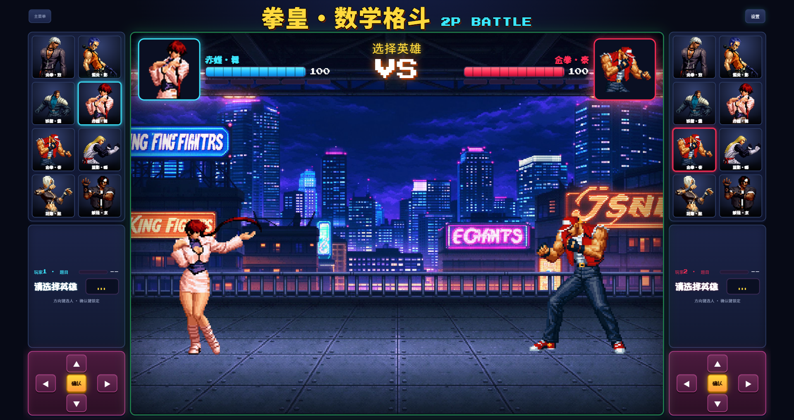
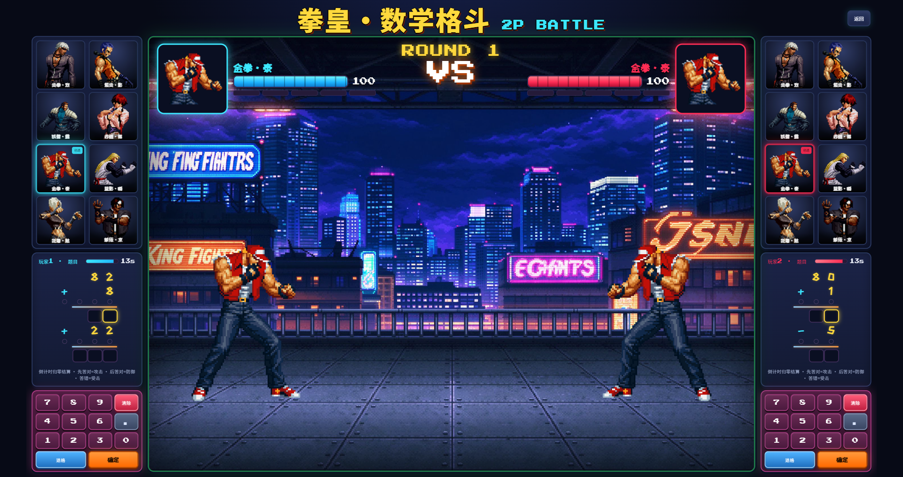

# 拳皇·数学格斗（2P Battle）

> 双人同屏 · 答题放招 · 小学数学格斗对战

一个像素街机风格的双人数学对战小游戏：两个玩家共用一块键盘，通过速答数学题来操控角色出招攻击对方。横式/竖式两种出题模式，8 个可选角色，连击系统，超必杀能量槽——把枯燥的口算练习变成一场拳皇对决。

## 玩法

- **两名玩家共用一个键盘**，左侧玩家用方向键选人、数字小键盘答题；右侧玩家用右侧方向键选人、右侧数字键答题。
- 每回合倒计时结束时统一结算：**先答对**的玩家冲向对手出招，**后答对**的原地防御（只受少量伤害），**答错或超时**无法防御。
- 连续答对累积 COMBO，达到段位触发不同招式（普通 1 连 / 强化 3 连 / 超必杀 8 连，可在设置里调）；答错连击清零。
- 累计答对 10 次触发能量槽**超必杀**。

## 出题模式

- **横式计算**：形如 `76 - 59 = ?` 的传统横式填空。
- **竖式计算**：标准竖式数位对齐，从个位开始从右到左填空，支持乘法多位数×两位数（无进位）、三数连加/连减/加减混合。
- **数字 0 限制**：可设置禁用 0，全程纯 1~9 运算，适合进阶练习。
- 难度分简单 / 普通 / 困难三档，倒计时时长可调。

## 运行方式

### 方式一：直接打开网页

双击 `index.html` 即可在浏览器中游玩，无需安装任何依赖。

### 方式二：exe 桌面版

下载 `拳皇数学格斗.exe`，双击即可运行（Windows 系统，基于 WebView2，Win10/11 自带）。

## 操作说明

| 操作 | 玩家1（左） | 玩家2（右） |
|---|---|---|
| 移动光标选人 | 方向键 ↑↓←→ | 右侧方向键 ↑↓←→ |
| 确认选择 | 小键盘 Enter / 确认键 | 右侧确认键 |
| 输入数字 | 小键盘 0-9 | 右侧数字键 0-9 |
| 退格 / 清空 / 提交 | 小键盘对应键 | 右侧对应键 |

竖式模式下支持点击任意填空格定位焦点，退格删单格，清空键一键重填。

## 技术栈

- 纯原生 HTML / CSS / JavaScript，无任何框架依赖
- Canvas 像素角色动画 + Web Audio 合成音效
- 桌面版使用 PyWebView + WebView2 打包

## LICENSE

MIT License，详见 [LICENSE](LICENSE)。
